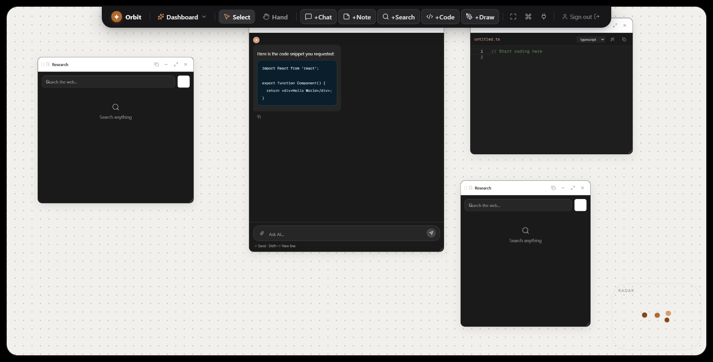
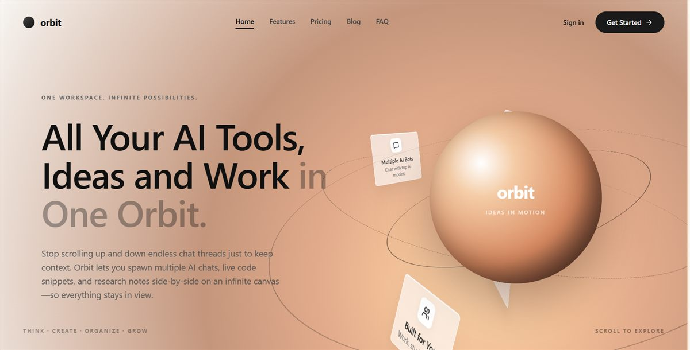

<div align="center">

# ✦ Orbit

**All your AI tools, ideas and work — in one orbit.**

[](https://orbit-tau-black.vercel.app)
[](https://nextjs.org)
[](https://react.dev)
[](https://www.typescriptlang.org)
[](https://tailwindcss.com)
[](https://github.com/Aadi-110i/Orbit/actions/workflows/ci.yml)
[](LICENSE)

</div>

---

## The Problem

Every AI tool wants to be its own tab. You start a ChatGPT thread, then a Claude
thread, then a search, then a code editor, then somewhere to take notes. Thirty
minutes later your research is in four windows, your code is in a fifth, and you
have lost the thread of what you were actually trying to build.

Context-switching isn't a productivity problem you can fix with discipline. It is
a design problem in the tools themselves.

**Orbit** replaces the tabs with a single **infinite spatial canvas**. AI chats,
web research, code and notes are all *containers* you place on that canvas, exactly
where they belong — side by side, connected, visible at a glance. Instead of
scrolling a chat history to recover context, you *see* your context.



<p align="center"><em>The live workspace: an infinite canvas with AI chat, web research, a Monaco code editor and a radar minimap — all on one screen.</em></p>

---

## Core Features

### 1. Infinite Spatial Canvas
Pan and zoom across a limitless board (0.2×–3×). Every container is draggable,
resizable, stackable and independently minimizable into a tray. A **radar minimap**
keeps you oriented when the board grows, and **Fit Canvas View** frames your whole
workspace in one keystroke.

### 2. Multi-Model AI Chat
Bring your own key (BYOK) and talk to **OpenAI, Anthropic, Gemini, Mistral,
OpenRouter, DeepSeek and Perplexity** — one model per chat, switched per container.
Responses stream token-by-token over SSE and render as GitHub-flavoured Markdown.

### 3. Integrated Code Studio
A real **Monaco Editor** with syntax highlighting for 15 languages, live filename
and language controls, one-click copy, and a **"Add code to AI context"** action
that feeds the open snippet straight into a chat window.

### 4. Spatial Notes, Web Research & Freeform Drawing
Markdown notes with autosave, a dedicated web-research panel, and a freeform canvas
with pen, rectangle, circle, line, arrow, text and eraser tools (with undo).
Search results can be sent straight into an AI conversation as context.

> **The glue: the Context Bridge.** A code snippet or a search result isn't trapped
> inside its own window — one click attaches it to any chat on the board, where it
> shows up as a context chip and travels with your next message. That is the
> difference between "ten apps in ten tabs" and one workspace.

---

## What I Built

I designed and built Orbit end-to-end — product concept, canvas engine, AI layer,
auth, design system and marketing site.

### The canvas engine
The core of the product is a viewport transform (`panX`, `panY`, `zoom`) applied to
a DOM layer rather than a canvas element, which keeps every container a normal,
accessible React component. Zoom is clamped and anchored, hit-testing is handled
in screen space, and stacking is managed with an explicit `zIndex` per container.

### The container system
Containers are a **discriminated union** (`chat | note | search | code | drawing`)
over a shared base of position, size, z-index and window state, with per-type state
factories. `ContainerRenderer` maps the type to a component, so adding a sixth
container type is a type change plus one component — not a rewrite.

### The AI layer
A single provider registry drives both the model picker UI and the server. Each
provider is reached with a **plain REST + SSE call**, so there are no provider SDKs
to maintain and the app has zero vendor lock-in. The route handles:

- **Per-container model selection** — each chat runs its own model and provider.
- **Model self-healing** — providers retire models constantly, so an unknown or
  retired model ID silently falls back to the provider's current default instead of
  erroring out.
- **Human-readable errors** — raw `401`/`404`/`429` responses from seven different
  providers are translated into one actionable sentence.
- **A demo mode** — the app is fully explorable before you ever connect a key.

### The context bridge
A code snippet or a search result can be attached to any chat as a typed
`ContextSource`. The chat renders those attachments as chips, and they are
**prepended to the outgoing message** so the model actually sees them. This is what
makes the canvas an *AI* workspace rather than a whiteboard with a chatbot on it.

### Authentication
A deliberately dependency-light auth layer: **bcrypt** (12 rounds) for password
hashing, **jose**-signed HS256 **JWTs** in an httpOnly cookie, and four API routes
for signup, login, session and logout.

### The design system and marketing site
A glassmorphic dark theme with amber accents, a **Three.js** hero, a **Framer
Motion** editorial section, a live interactive canvas demo embedded in the landing
page, and a comparison/pricing table — all built to ship the product, not just the
prototype.

---

## Screenshots

**Landing page** — 3D hero, feature grid, live interactive canvas demo.



**Workspace** — the infinite canvas with the radar minimap and unified taskbar
([full-resolution](docs/screenshots/workspace.png)).

---

## Tech Stack

| Layer | Choice |
| --- | --- |
| Framework | **Next.js 16.3.5** (App Router, Turbopack) + **React 19.2** |
| Language | **TypeScript 5** (strict) |
| Styling | **Tailwind CSS v4**, CSS custom properties for theming |
| State | **Zustand** with the `persist` middleware + versioned migrations |
| Editor | **Monaco Editor** (`@monaco-editor/react`) |
| 3D / Motion | **Three.js**, `@react-three/fiber`, `@react-three/postprocessing`, **Framer Motion** |
| AI | Plain REST + SSE to 7 providers, **BYOK** (no vendor SDKs) |
| Auth | **jose** (JWT), **bcryptjs** |
| Data | **Convex** schema (canvases / nodes / edges / messages / branches) — in progress |
| Hosting | **Vercel** |

---

## Getting Started

```bash
git clone https://github.com/Aadi-110i/Orbit.git
cd Orbit
npm install
npm run dev
```

Open [http://localhost:3000](http://localhost:3000). **No API keys are required to
run or explore Orbit** — connect a provider from the in-app *Connect an AI
provider* dialog whenever you want live models. Keys stay in your browser and are
never stored on Orbit's servers.

### Environment

```bash
cp .env.example .env.local
```

| Variable | Required | Purpose |
| --- | --- | --- |
| `JWT_SECRET` | Production | Signs session JWTs |
| `NEXT_PUBLIC_CLERK_PUBLISHABLE_KEY` / `CLERK_SECRET_KEY` | Optional | Reserved for a future hosted-auth swap |
| `CONVEX_DEPLOYMENT` / `NEXT_PUBLIC_CONVEX_URL` | Optional | Cloud persistence (in progress) |
| `LLM_BASE_URL` / `LLM_API_KEY` / `LLM_MODEL_DEFAULT` | Optional | Server-side model default for the AI route |

### Scripts

```bash
npm run dev     # start the dev server
npm run build   # production build
npm run start   # serve the production build
npm run lint    # eslint
```

---

## Project Status

Honest snapshot of where each piece stands:

| Area | Status |
| --- | --- |
| Infinite canvas, pan/zoom, resize, z-order, minimap, fullscreen | ✅ Shipped |
| AI chat — streaming, 7 providers, BYOK, per-container model | ✅ Shipped |
| Markdown rendering, model self-healing, friendly provider errors | ✅ Shipped |
| Monaco code editor, 15 languages, add-to-chat context | ✅ Shipped |
| Notes, drawing tools with undo, context bridge | ✅ Shipped |
| Auth — signup, login, JWT session, logout | ✅ Shipped (in-memory users) |
| Command palette, context menus, keyboard shortcuts | ✅ Shipped |
| Web research panel | 🟡 Prototype — curated demo results |
| Code execution | ⏳ Planned — sandboxed runner not built yet |
| Cloud persistence (Convex schema) | 🟡 Schema ready, not wired to the client |
| ESLint (React Compiler rules) | 🟡 In progress — 9 pre-existing errors in the canvas layer |
| Automated tests | ⏳ Planned |

---

## Roadmap

- [ ] Wire the Convex schema to the client for real cross-device persistence
- [ ] Replace the demo search results with live retrieval (Perplexity / Tavily)
- [ ] Sandboxed code execution inside the Code Studio container
- [ ] Real-time multiplayer canvases (the `edges` + `branches` schema is already there)
- [ ] Chrome extension that drops any page onto the canvas
- [ ] Test suite + Playwright coverage of the canvas engine

---

## Contributing

Contributions are welcome — issues and PRs both.

1. Fork the repo and create a branch: `git checkout -b feature/your-idea`
2. `npm install && npm run dev`
3. Keep the type system happy — `npm run build` must pass (it runs a full TypeScript check)
4. Open a PR describing what you changed and why

**Roadmap items and good-first-issues are listed above** — the search, execution and
persistence work are all open, self-contained and well-scoped.

---

## License

Released under the [MIT License](LICENSE).

---

## Acknowledgements

- [Monaco Editor](https://microsoft.github.io/monaco-editor/) for the code editor
- [Zustand](https://zustand.docs.pmnd.rs) for the canvas state layer
- [Three.js](https://threejs.org) and [Framer Motion](https://motion.dev) for the 3D hero and transitions
- [OpenRouter](https://openrouter.ai) for making a hundred models reachable with one key

---

## Contact

Built by **Aadarsh Sharma** — [GitHub](https://github.com/Aadi-110i) · [Portfolio](https://portfolio-three-weld-ivmyjx38u6.vercel.app/) · [aadarsh89sharma@gmail.com](mailto:aadarsh89sharma@gmail.com)

If Orbit saved you some tab-switching, I'd love to hear about it.
